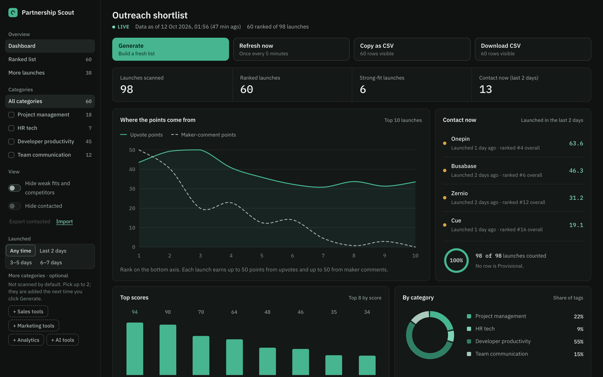
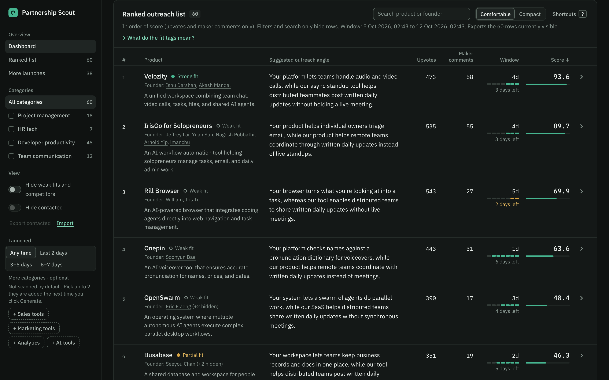
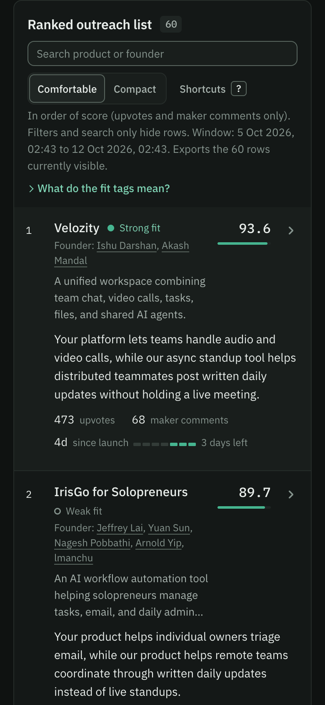
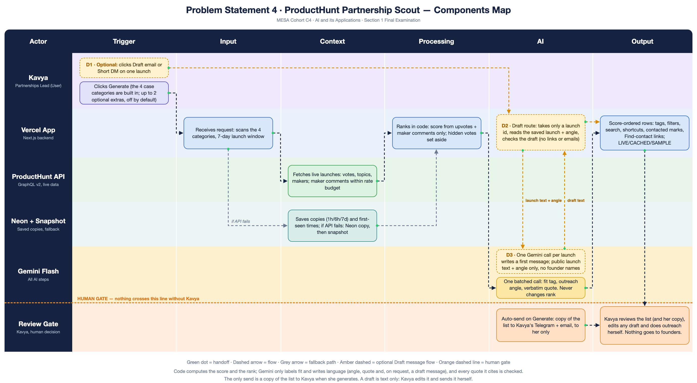

# ProductHunt Partnership Scout

A ranked outreach list for Kavya, who leads partnerships at a B2B SaaS company that helps remote teams run async standups. One click scans Product Hunt launches from the **last 7 days** in four categories (project management, HR tech, developer productivity, team communication) and returns the launches in score order with the six fields the case asks for: product name, founder name, one-line description, upvote count, days since launch and a suggested outreach angle that explains how Kavya's product could complement theirs.

**The tool never contacts founders, never looks up emails and never sends outreach. When Kavya clicks Generate it also sends a copy of the list to her own Telegram and email.** Kavya reads the list and does all outreach herself (the human review gate on the Components Map). The copy goes only to the recipients configured on the server, never to anyone else.









Components Map: [docs/components-map.png](docs/components-map.png)

The UI is a dark, flat and dense dashboard (stepped charcoal surfaces, hairlines, one green accent, no glass or glow) built with original CSS and inline SVG; nothing was copied and no images are used. The ranked list is a ledger of rows, not cards. Fonts (IBM Plex Sans and Plex Mono) are downloaded when the site is built and served from the site itself, so a visit makes no request to a font host. The research behind the design is in `DESIGN_RESEARCH.md` in the project folder.

## How it works

1. **Generate** (Kavya) calls `POST /api/scout`. The four categories from the case are built in and always scanned (`lib/categories.ts`). **Optional extra categories** (Sales tools, Marketing tools, Analytics, AI tools) are **off by default**: Kavya can switch on up to 2 under "Add optional categories" and they are added to her next Generate (the choice is remembered in her browser). Only ids from this fixed menu are accepted (the page cannot send topic names), and only from a browser on this site, because each extra topic costs about 400 Product Hunt API points to read and its launches need maker-comment counts. Each combination of extras has its own saved list (1 hour); the scheduled refresh keeps only the default list warm, so the first Generate after switching an extra on is slower and some extra launches may be Provisional until later runs. If live data is unavailable the app falls back to the four main categories and says so. Launches are tagged and filterable by an extra category only while it is switched on.
2. The server fetches launches (featured or not) from the last 7 days through the Product Hunt GraphQL API v2. It reads each of the six topics behind the four categories by votes, **4 pages (80 launches) deep**, de-duplicates by post id, and keeps **25 launches per category chosen by both signals**: a 50/50 blend of upvotes and total comments (`potentialOf` in `lib/score.ts`). Total comments are free in the list query and are an upper bound for maker comments (every maker comment is a comment), so a launch with fewer votes but a very busy thread is not cut just for sitting lower by votes. This only decides who is considered; the real score and rank still use upvotes and maker comments alone.
3. It counts **maker comments** (top-level comments and replies written by one of the launch's makers, matched by user id) down the ranked list, up to 40 launches, stopping early when the Product Hunt rate-limit budget falls to a reserve.
4. **Score and rank are computed in code.** Gemini never touches the order.
5. **Gemini Flash** (`@google/genai`) labels partnership fit and writes a one-liner, an outreach angle and a verbatim evidence quote, in batched calls. Only launches without a saved result are sent. Only launch text is sent (name, tagline, description, topic names): no maker or commenter names or ids.
   **Draft message:** each row with an angle has a button that asks Gemini Flash (one call, saved in Neon for 7 days) for a short first message in Kavya's voice. It sees only public launch text and the saved angle, never founder names: the greeting carries a placeholder that the page fills in with the founder first name already on screen. She picks **Email** (subject and body) or **Short DM** (a few lines for LinkedIn or Product Hunt), edits it, copies it and sends it herself from her own accounts. Links and email addresses in the draft are rejected, the endpoint accepts only a launch id from the page, and nothing is sent by the tool.
6. Code **verifies every quote** against the launch tagline and description. A quote that fails twice is shown with an "Unverified" tag, never hidden.
7. The list is shown in score order with tags (fit, category, urgency), category filters in the sidebar (tick one, several or all; a launch shows if it matches any ticked category), a "Hide weak fits and competitors" switch, a "Launched" filter (any time, last 2 days, 3 to 5 days, 6 to 7 days), a search box for product or founder name and a "Hide contacted" switch (all of these only hide rows), and a source badge: **LIVE**, **CACHED** or **SAMPLE**.

If Product Hunt fails the app serves the saved copy from Neon labelled **CACHED** (with its original fetch time), and if there is none, the bundled snapshot labelled **SAMPLE**. If Gemini fails, every row keeps its rank and shows neutral text with an "AI summaries unavailable" banner.

## Ranking formula

```
V = votes / maxVotes
M = makerComments / maxMakerComments
Score = 100 x (0.5 x V + 0.5 x M)
```

`maxVotes` and `maxMakerComments` are the best values among the current launches. **Assumption: the case names upvotes and maker comments but gives no weights, so they count equally (0.5 each).** This is one constant in `lib/config.ts`. Nothing else enters the score. Fit, urgency, category and tags are labels and never change the order. Ties: newer launch first, then product name. Every row has a "How this was scored" note whose numbers add up to its score.

**Coverage.** Not every launch in the window is read: the biggest topics hold about 1,000 launches a week, and each list page costs about 100 API points. Reading 80 per topic reaches launches with roughly 50 votes in those topics, and in the smaller categories it reaches everything with any votes. A launch below that depth would need roughly 60 or more maker comments (almost as many as the best launch of the week) on around 50 votes to enter the top 5, which does not happen in practice. Measured on 11 Oct 2026: widening the pool from 78 to 98 launches did not change the top 20 (the best newly found launch ranked #21).

**Maker-comment limit.** Counting maker replies costs Product Hunt API points (about 100 per page of comments; the limit is 6,250 points per 15 minutes), so one run fetches counts for at most 40 launches (highest potential first) and stops earlier if the budget falls to a reserve of 1,500 points. **Counts accumulate:** every run (Generate, Refresh now and `/api/refresh`) fetches only launches that have no valid saved count, most upvotes first, and each count is saved for 6 hours, so after a few runs nearly every launch has a real count. A launch that has not been reached yet shows "not counted" and its score is tagged **Provisional**: it treats maker comments as 0, so the true score can only be higher. If a saved count has expired and cannot be refreshed, it is kept but labelled as a saved copy (CACHED). The page says "counted for N of M launches" and how many rows are Provisional.

Launches posted today often show 0 votes because Product Hunt hides them; those go to **Too early to rank** instead of the bottom of the list.

## Small extras on the page

- **Made for Kavya's workflow:** each ranked row is one line of a ledger with right-aligned figures (upvotes, maker comments, days since launch with a 7-segment window bar, score with a thin bar); a Comfortable or Compact density switch (remembered in the browser) fits more rows on screen; keyboard: j and k move, Enter opens, c marks contacted, / searches, ? lists the keys (nothing fires while typing); rows slide to their new place when a filter changes; each row links to the founders' public Product Hunt profiles and to the product's own site (links from Product Hunt, https only; the tool never looks up emails). An expanded row also has "Find contact yourself": links that open a LinkedIn people search for each founder and a web search for the product, built in the browser from names already on screen. They look up nothing and store nothing, so Kavya finds any contact details herself; **Mark as contacted** on a row remembers it in her browser only (localStorage `ph-scout:contacted`, never sent anywhere) so she can hide what she has already handled; **Export contacted** saves those notes to a small file on her computer and **Import** reads such a file back (merged, only plain ids and dates are accepted), so clearing the browser or switching computers does not lose them. Each row's window cell also says how many days are left in the 7-day window (approximate, because Product Hunt gives launch dates by day; amber for the last two days).
- **Copy as CSV / Download CSV** export exactly the rows currently visible (the first column "#" is the position in the file; "overall rank" is the rank in the full list, so it skips numbers when a filter is on) (chips and the fit switch applied, in the order shown; "More launches" rows only while that section is open). It runs in the browser from data already on the page, and cells that start with `=`, `+`, `-` or `@` are prefixed with an apostrophe so spreadsheets do not run them as formulas.
- Rows whose fit is "Likely competitor" are dimmed, not removed, and the order never changes.
- **Dashboard overview** above the list: a stat strip (launches scanned, ranked, strong-fit, contact now), a chart of where the top 10 launches get their points (upvote points and maker-comment points, from each row's score breakdown), top-score bars, a category share donut, a maker-comment coverage gauge and a "Start here" card for the rank 1 launch. Every figure is computed in the browser from the response already returned, with no extra requests, and none of it changes a score or the order.
- A coverage line above the list shows how many launches have their maker comments counted and how many rows are Provisional.

## Copy to Kavya (Telegram and email)

Every time Kavya clicks **Generate**, the server also sends a copy of the freshly built list (top 10 by score). The message opens with context (when she clicked Generate, the 7-day window, the categories, the data source) and each launch shows its rank, name and fit tag, a one-line description, founders, why it ranks there (score out of 100 from upvotes and maker comments, days since launch), the AI-suggested angle and the Product Hunt link; it ends with a short "how to read this" note to **her own Telegram and email** (times in the message are in IST). Only a real Generate click does this: not Refresh now, not `/api/refresh`, not the GitHub Action, not a page load. The page cannot choose recipients or text; both come from server environment variables. It is limited to **one copy per 5 minutes** (kept atomically in Neon), never sent for SAMPLE data, and a failure never affects the list. A public visitor who clicks Generate also triggers a copy to Kavya; the cooldown keeps that to at most 12 an hour. The page shows one quiet line ("Copy being sent…", "Not sent: next copy in 4:12"). **To turn it off, unset `NOTIFICATIONS_ENABLED` (or set it to anything but `true`) and redeploy.** Variables: `NOTIFICATIONS_ENABLED`, `TELEGRAM_BOT_TOKEN`, `TELEGRAM_CHAT_ID`, `RESEND_API_KEY`, `NOTIFY_EMAIL`. Telegram and Resend are not AI; Gemini Flash is still the only AI.

## Saved copies (Neon Postgres)

Neon Postgres (free plan, added through the Vercel Marketplace) stores **only public Product Hunt launch data, maker-comment counts, Gemini outputs and the first time each launch id was seen** (table `cache_entries`: launch list 1 hour, maker-comment counts 6 hours, Gemini results 7 days; table `launch_seen` powers the display-only "New since your last visit" tag). No secrets, no emails, no personal data. `db/schema.sql` is idempotent. If `DATABASE_URL` is missing or Neon is down, the app still works: it fetches live every time (slower, and it spends more Product Hunt rate budget) and, if that fails too, falls back to the bundled snapshot labelled SAMPLE.

- **Refresh now** refetches the launch list at most once every 5 minutes (limit kept in Neon, so it holds across server instances) and reuses still-valid counts and Gemini results.
- `/api/refresh` (needs `Authorization: Bearer <CRON_SECRET>`, otherwise 401) runs the same pipeline with the same API budget to warm the saved copies and deletes long-expired rows. A GitHub Actions workflow calls it every 15 minutes (GitHub's free scheduler is best-effort, so real gaps of 15 to 35 minutes are normal) and `vercel.json` has one daily cron (Hobby allows once a day). Generate works without either. The Product Hunt budget (6,250 points per 15 minutes, shared by the job and by any visitor action that needs fresh data) is why one run counts at most 40 launches: running the job more often does not add budget, and in steady state saved counts (6 hours) and the saved list (1 hour) keep almost every Generate click free of Product Hunt calls.

## Environment variables (names only)

| Name | Purpose |
|---|---|
| `PH_API_TOKEN` | Product Hunt developer token (server-side only) |
| `GEMINI_API_KEY` | Google AI Studio key (server-side only) |
| `GEMINI_MODEL` | Gemini Flash model id (default `gemini-3.8-flash`) |
| `DATABASE_URL` | Neon pooled connection string (added by the Vercel Neon integration) |
| `CRON_SECRET` | Protects `/api/refresh` |
| `NOTIFICATIONS_ENABLED`, `TELEGRAM_BOT_TOKEN`, `TELEGRAM_CHAT_ID`, `RESEND_API_KEY`, `NOTIFY_EMAIL` | Optional copy of the list to Kavya (see above) |

Secrets live only in `.env.local` (git-ignored), Vercel env vars and GitHub Actions secrets. See `.env.example`.

## Run it

```bash
npm install
cp .env.example .env.local   # fill in the values
npm run db:apply             # creates the tables in Neon (optional)
npm run dev
npm test
```

Kavya's company profile (what Gemini may say about her product) is in `config/profile.ts`.

## Notes

- Live data comes from the Product Hunt API, which is meant for **non-commercial** use by default. This is an exam demo and is not presented as a commercial product.
- Gemini Flash is the only AI used. No other AI provider is part of the app. Telegram and Resend are used only to deliver the copy to Kavya.
- Days since launch is whole days only (Product Hunt's launch time is day-level).
- The app sends basic browser security headers (no sniffing, no framing, a strict referrer policy) and passes an automated accessibility scan (axe) on the landing page, the dashboard, an expanded row and the fit legend, on desktop and phone widths.
